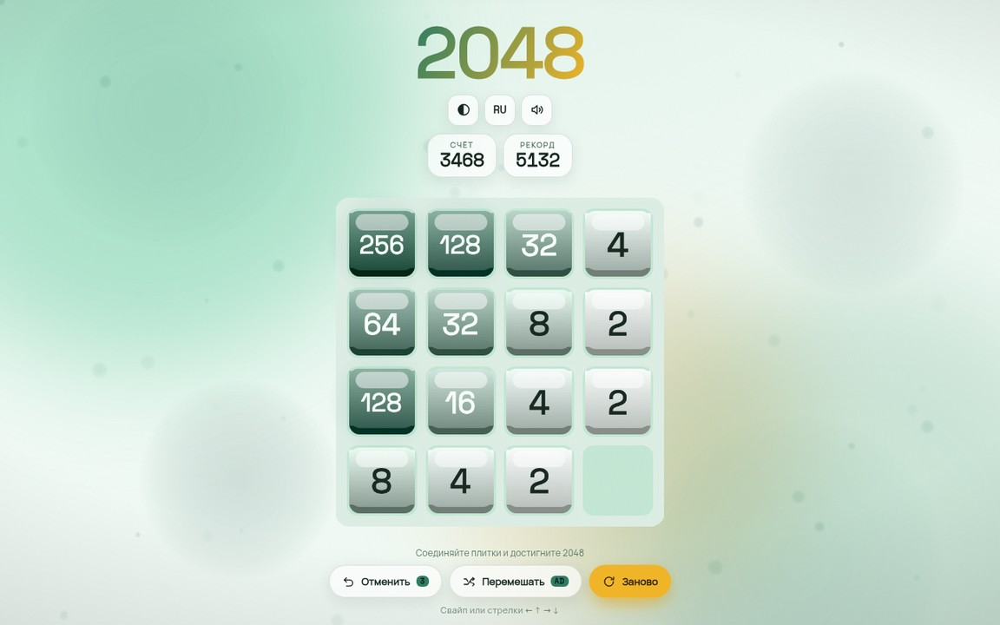

# 2048 · Modern Minimal



Классическая головоломка 2048 в современном исполнении: физичные 3D-плитки, четыре темы
оформления, живой фон, интеграция с игровыми площадками (Яндекс Игры, VK) и встроенная
аналитика. Чистый JavaScript + [Phaser 3](https://phaser.io), без сборщиков и зависимостей —
достаточно открыть `index.html`.

## Возможности

- Полная игровая логика 2048: слияние цепочек за один ход, победа на 2048 с продолжением
  партии, корректное определение поражения
- 3D-плитки: вертикальный градиент, тёмная грань, глянцевый блик — все текстуры
  генерируются на лету, графических ассетов нет
- 4 темы (jade / amber / velvet / neon), у каждой свои палитры плиток и фона; живой фон
  с орбами и пылью
- Отмена хода: 3 бесплатных, далее через rewarded-рекламу; перемешивание доски и
  возрождение после поражения — также через rewarded
- Управление: стрелки, WASD, свайпы; ввод блокируется на время анимаций и оверлеев
- Счёт, рекорд, звук, язык (RU/EN) и тема — сохранение в localStorage
- SDK и реклама подключаются только на площадках: Яндекс Игры (rewarded, interstitial,
  GameplayAPI), VK (нативная реклама через VK Bridge); вне площадок — демо-режим
  без сетевых вызовов
- Аналитика: собственное ядро «Game Analytics Standard» — сессии, игровые события,
  тех-ошибки, локальная очередь с досылкой

## Запуск

Без сервера — просто открыть `index.html` в браузере (`file://`).

Через статический сервер:

```bash
python3 -m http.server 8787
# http://localhost:8787
```

Phaser и веб-шрифты подтягиваются с CDN (jsdelivr). Логотип использует шрифт
Kabyta Italicexpanded: положите файл в `fonts/` (см. `fonts/ПОЛОЖИТЬ_ШРИФТЫ_СЮДА.txt`),
иначе используется запасной вариант из системных шрифтов.

## Управление

| Действие        | Как                                       |
| --------------- | ----------------------------------------- |
| Ход             | стрелки, WASD или свайп                   |
| Отменить ход    | кнопка «Отменить» (3 бесплатно, далее AD) |
| Перемешать      | кнопка «Перемешать» (AD)                  |
| Новая игра      | кнопка «Заново»                           |

## Структура проекта

```
index.html          разметка, HUD, подключение модулей
css/style.css       интерфейс и адаптивность
css/fonts.css       подключение шрифтов логотипа
js/util.js          утилиты: цвета в Lab, обёртка аналитики
js/storage.js       localStorage с валидацией
js/analytics.js     ядро аналитики: сессии, очередь, транспорт
js/i18n.js          локализация RU/EN
js/state.js         состояние: счёт, рекорд, звук
js/themes.js        темы: палитры 2D/3D-плиток, фоны
js/audio.js         звук
js/ads.js           демо-реклама вне площадок
js/platform.js      SDK Яндекс/VK, rewarded/interstitial, GameplayAPI
js/hud.js           HUD: кнопки, оверлеи, тосты
js/scene.js         Phaser-сцена: поле, плитки, анимации, логика ходов
js/main.js          загрузка, инициализация, resize, видимость вкладки
docs/screenshot.jpg скриншот для README
```

## Платформы и реклама

- **Яндекс Игры** — SDK грузится только внутри iframe площадки: rewarded
  (`showRewardedVideo`), interstitial (`showFullscreenAdv`, кулдаун 60 с перед новой
  партией), GameplayAPI (`start`/`stop` — обязателен к публикации)
- **VK Mini Apps** — VK Bridge при параметре `vk_app_id` в URL; нативная реклама
  `VKWebAppShowNativeAds` с `ad_format: 'reward' | 'interstitial'`
- **Вне площадок** (включая `file://`) — демо-оверлей rewarded, interstitial тихо
  пропускается, сетевые SDK не загружаются

Публикация: заархивируйте содержимое папки (index.html в корне архива) и загрузите
в консоль разработчика площадки, затем включите рекламные блоки в консоли.

## Аналитика

События: `level_start`, `game_restart`, `game_win`, `game_fail`, `game_continue`,
`undo_used`, `shuffle_used`, `revive_used`, `ui_settings`, `ad_*`, плюс сессии и
тех-категория (JS-ошибки, ошибки ресурсов, longtask).

Транспорт — Яндекс.Метрика: ID счётчика задаётся константой `METRIKA_ID` в
`js/analytics.js`. На `file://` счётчик не грузится — события копятся в локальной
очереди и досылаются. Отладка: URL-параметр `?za-debug`, `ZA.state()`, `ZA.dump()`.

## История ревизий

- **8** — аудит проекта: фиксы гонки перемешивания [F9] и формата VK-рекламы [F10];
  аналитика `js/analytics.js`; interstitial Яндекс/VK; GameplayAPI
- **7** — 3D-плитки по референсу: грань + градиент + блик, послойный рендер,
  per-theme палитры
- **6.2** — favicon: inline SVG data-URI
- **6.1** — [F8] SDK грузятся только на площадках
- **6** — [F7] фикс скорости частиц; шапка в 3 центрированные строки
- **4** — [F5] Lab-градиент плиток, [F6] обновление цифр после слияния
- **1–3** — базовый порт: сцена, логика ходов, HUD, темы, сохранения
